# emoking · 虚拟烟替代挂件

> **emoking 不是「抽烟游戏」**：它是给**想戒烟**或**在工位/公共场所不能抽烟**的人用的「虚拟烟」替代工具——烟瘾上来时先点一支虚拟烟顶一下，帮助减少真实吸烟、辅助戒烟；在工位、办公室、电梯、商场等场所，用模拟代替真实吸烟，避免烟雾与二手烟污染环境。模拟不能替代专业戒烟治疗；烟瘾明显时建议咨询戒烟门诊或当地戒烟热线。**吸烟有害健康。**
>
> 给 [DeepSeek Harness](https://github.com/deepseek-ai/deepseek-harness)（DSH）做的「模拟抽烟」解闷挂件：等 AI 跑任务时，右下角开一包烟、取一支点上，**按住抽一口、松手吐烟**；烟灰会变长、会掉，抽完把烟蒂按进玻璃烟灰缸。有 47 款烟/25 个品牌、真实手图、雪茄剪茄帽动画和 18 个成就。**纯本地模拟娱乐，不含真实烟草，不涉及任何烟草销售。**

**v0.12.0** · 代码 MIT · [宣传片](docs/media/emoking-promo.mp4) · [Hub 提交信息模板](HUB-SUBMISSION.md)

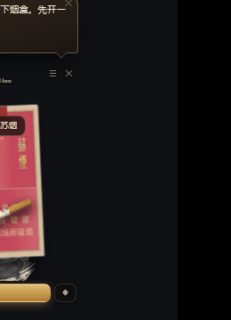

## 宣传片（47 秒）

[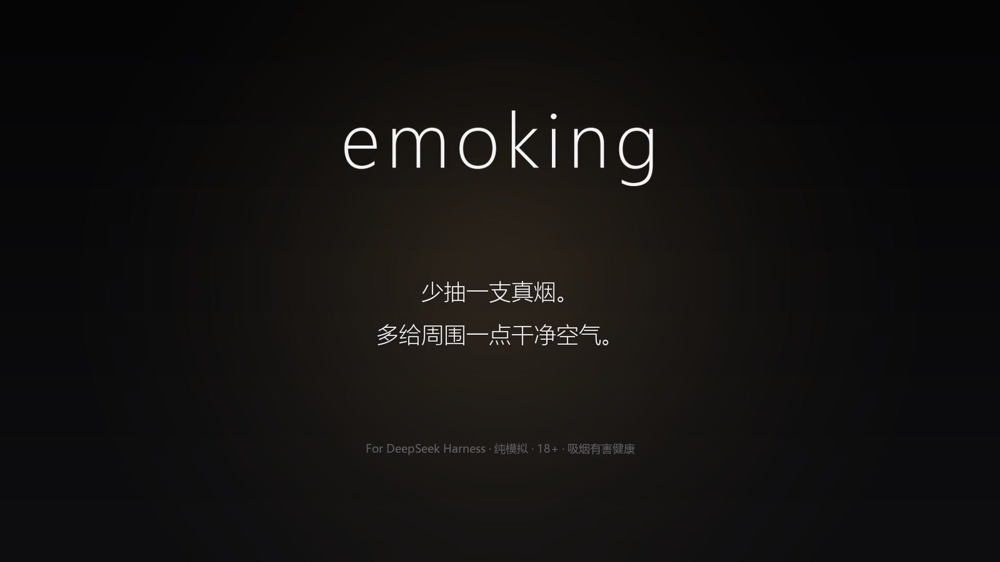](docs/media/emoking-promo.mp4)

- 带 BGM：[emoking-promo.mp4](docs/media/emoking-promo.mp4)（47s / 1080p；BGM 为版权音乐，仅本地/个人演示）
- 无声版：[emoking-promo-silent.mp4](docs/media/emoking-promo-silent.mp4)（公开发布请配平台曲库或已授权音乐）
- 分镜 / 文案：[emoking-promo-script.md](docs/media/emoking-promo-script.md)

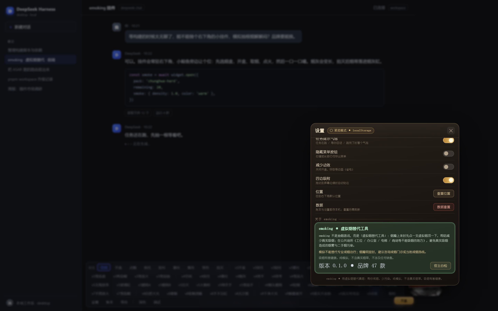

> ⚠️ **18+ / 免责声明**：本项目是个人兴趣的界面模拟插件，不是烟草广告，不销售任何烟草制品，不诱导吸烟；**吸烟有害健康**。与 DeepSeek 及任何烟草品牌均无隶属关系。素材说明见 [CREDITS.md](CREDITS.md)。

## 功能亮点

- **真实烟盒 + 开盒动画**：点悬浮烟盒 → 盒盖翻开、锡纸反光、取烟（硬盒/软盒/细支/中支/雪茄木盒不同开法），开盒后只出现一支烟/一支雪茄。
- **第一视角真实手图**：常规/细支/雪茄分别用三张真实手部照片，按住吸气、松手吐烟。
- **烟量与按住时长成正比**：轻吸细烟、重吸大团白烟（多团分离、半透明、不白屏）。
- **连续的燃烧与烟灰**：烟头微光（吸气变亮）、烟灰随燃烧/口数/吸气强度累计，过长自动断落；可能烫到手或嘴（主动抖灰安全）。
- **自动熄灭**：点着后约 60 秒不抽会自动熄灭（雪茄约 90 秒），抽一口重新计时。
- **玻璃烟灰缸**：透明玻璃侧视款，烟蒂与烟灰累积；雪茄配深色烟熏款。
- **雪茄模式**：剪茄帽（真实雪茄剪素材 + 「靠近→咔嚓→移开」动画）、火烤点燃、两指夹持、更浓的烟。
- **18 个成就**：第一根、一整包、五连抽、首支细支/首支雪茄、开盒 10 次、累计 50 支、单日 20 支、20 个品牌、被烫、抖灰 10 次、连续 3 天、换过 10 种烟、雪茄剪帽、凌晨 2 点……账本里能看到解锁进度。
- **烟柜可调大小**：默认大窗，右下角可拖拽缩放；设置里可选中/大/特大。
- **可搓圆捏扁的挂件**：可拖到任意位置、隐藏成小圆点（小圆点也能拖）、缩放 0.7~2.0。
- **等任务联动**：任务运行中显示已等时长，等久了提示「任务还在跑，来一根？」；任务结束提醒掐烟。
- **纯本地**：不联网、不读凭据、不上传数据；配置与统计只写本机 `~/.dsh/smoke/`。

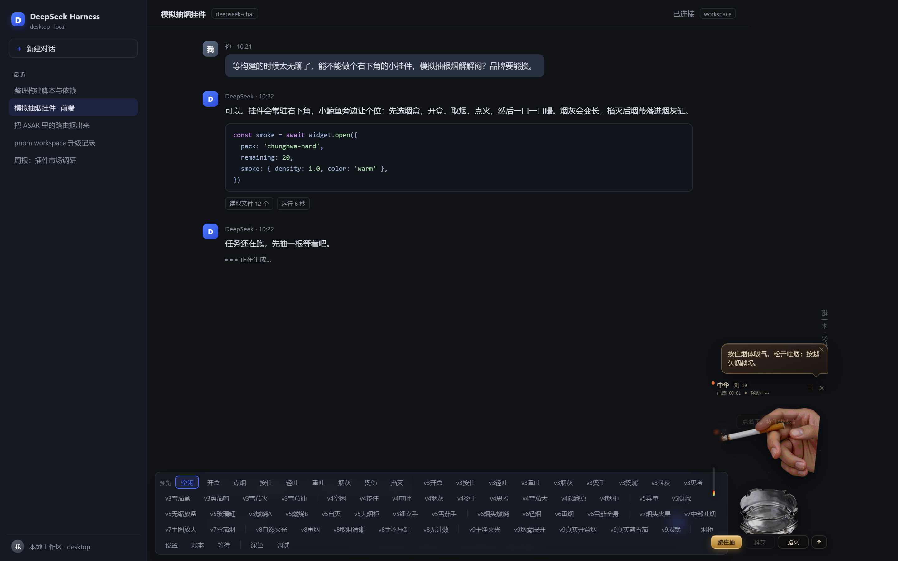

| 关于 emoking（戒烟/减少二手烟定位） | 账本：用虚拟烟替代真烟 |
|---|---|
|  | 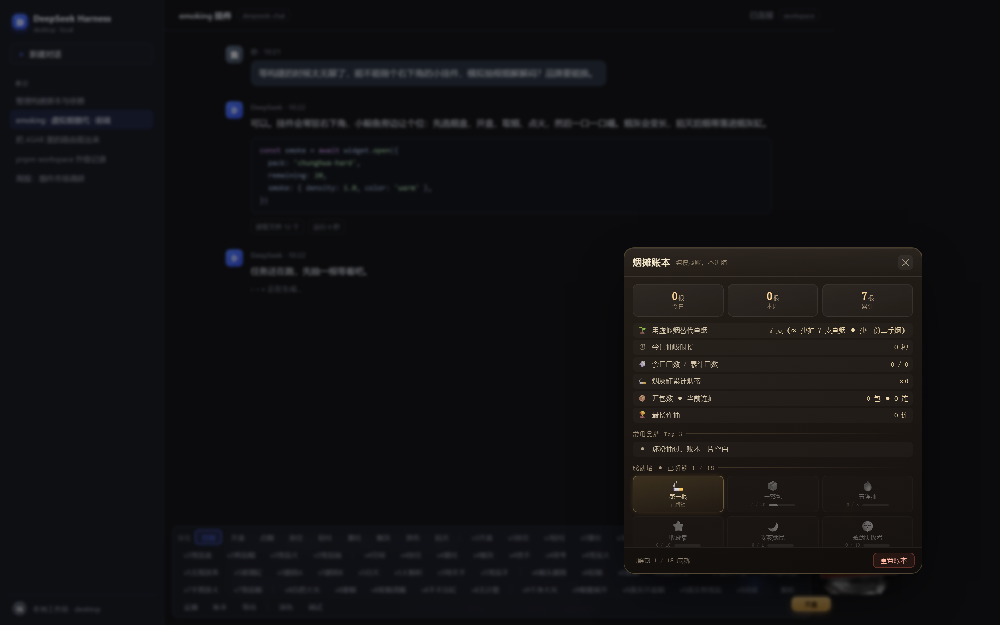 |

| 开盒：只出现一支真实香烟 | 雪茄：真实雪茄剪剪茄帽 |
|---|---|
| 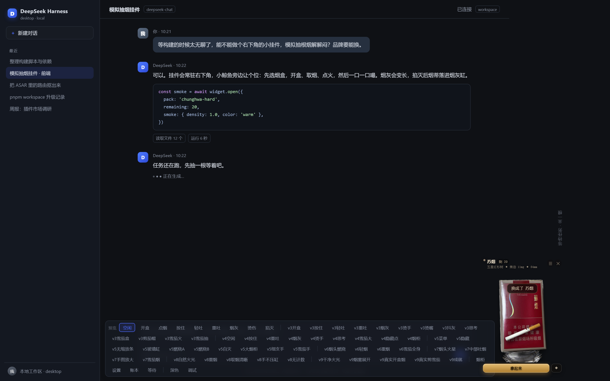 | 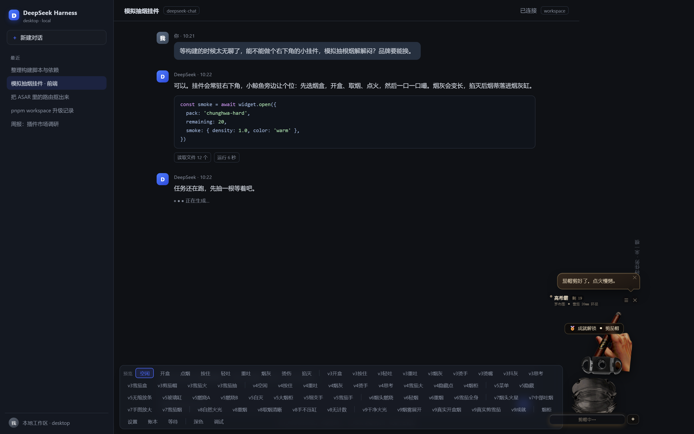 |

| 重吸：多团吐烟 | 贴图（局部放大） |
|---|---|
| 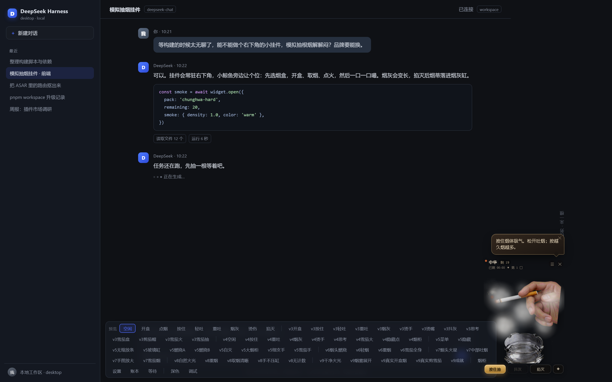 | 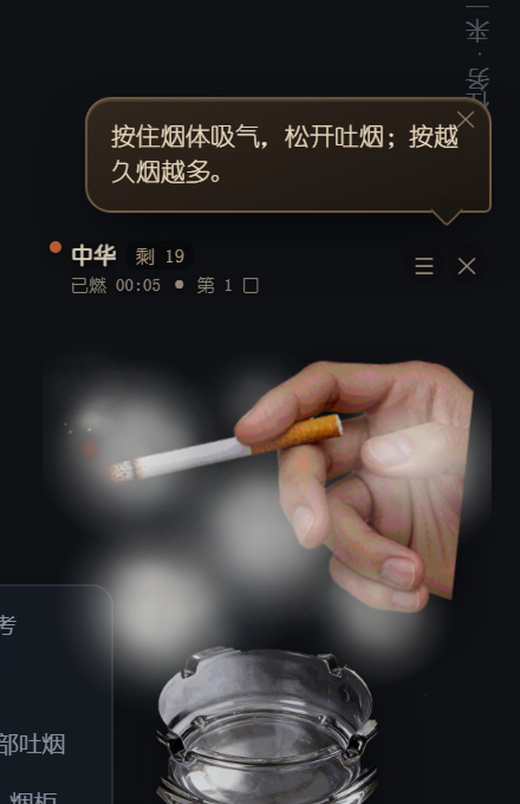 |

| 烟柜 | 成就 |
|---|---|
| 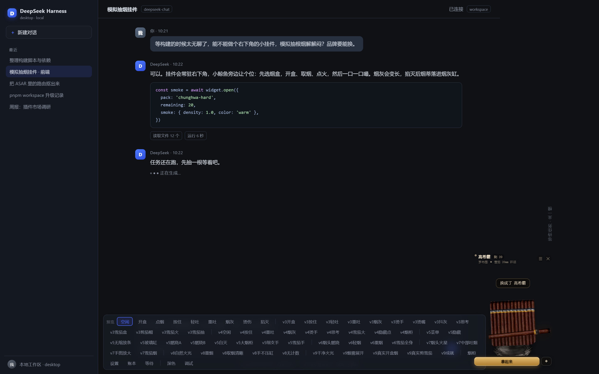 | 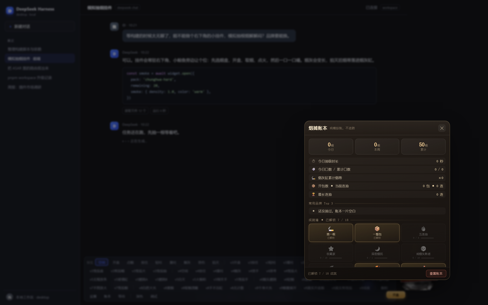 |

| 设置（字体已加大） | 关于 emoking（滚动） |
|---|---|
| 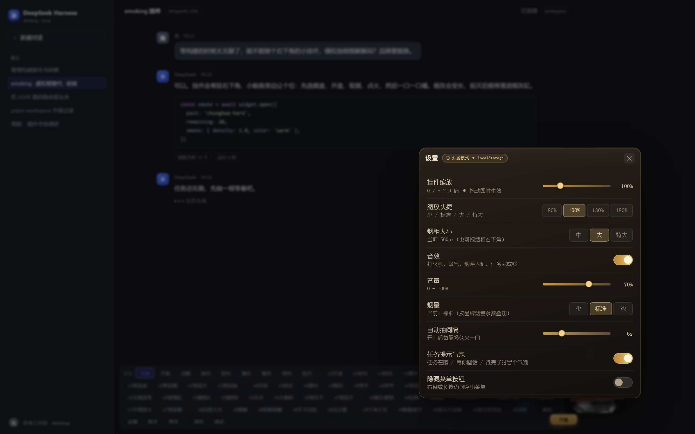 | 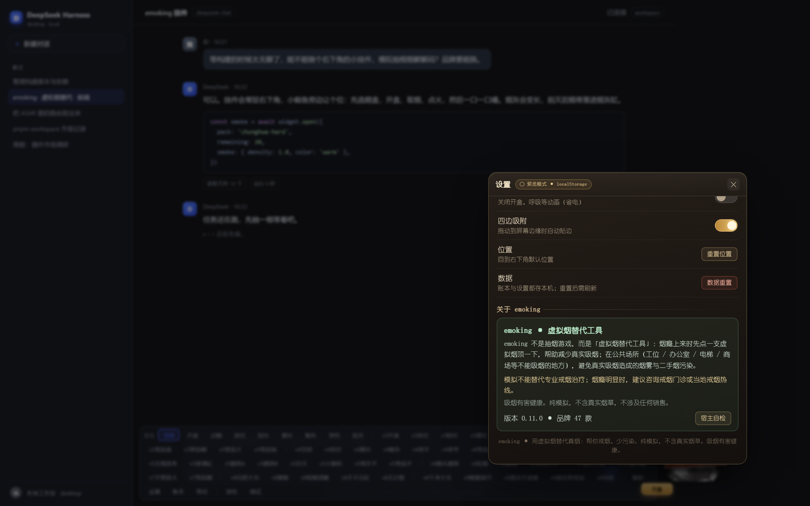 |

## 安装

### 桌面客户端（DeepSeek Harness 桌面版）

DSH 桌面端的 `desktop` profile 由 Electron 独占（CLI 拒绝 `--profile desktop`），请在应用内安装：

1. 打开 DSH → 侧栏 **插件** → **添加插件**；
2. 粘贴本仓库地址 `https://github.com/Bowie-Z-2001/emoking`（或 npm 包名 `emoking`）；
3. 安装完成后**完全退出 DSH（含托盘）再打开**；
4. 打开任意对话，右下角（小鲸鱼挂件左边）出现悬浮烟盒即成功。

### Web / CLI（`dsh web`）

```bash
# 从 npm 安装（推荐，需要先发布到 npm）
dsh plugin --profile web add emoking

# 或直接从 GitHub 安装（跟随默认分支，不跟版本）
dsh plugin --profile web add github:Bowie-Z-2001/emoking

# 卸载
dsh plugin --profile web remove emoking
```

安装后重启 `dsh web`，浏览器刷新页面。

### 兼容性

- 需要支持 **bundle 插件**（`dsh.bundle.patch`）的 DSH 版本：本项目在 DSH 桌面版 `0.2.1-rc.2` 上开发验证；Web 端需较新的 `dsh web`。
- Node.js `>= 20.19`（插件本体运行在 DSH 宿主内，实际由你的 DSH 版本决定）。
- 无需任何 API key 或网络；不需要给插件配置环境变量。

## 使用说明

1. **开盒**：点悬浮烟盒 → 开盒动画 → 点「拿起来」把烟拿到手里；
2. **点火**：点「点火」（雪茄是「剪茄帽」→ 火烤点燃）；
3. **抽**：按住烟支/主按钮（或键盘空格）吸气，松手吐烟；按得越久烟越大；
4. **抖灰**：点「抖灰」或烟灰缸，主动清灰永远安全；太久不抖灰会自己断落，可能烫到手或嘴；
5. **掐灭**：点「掐灭」把烟蒂按进烟灰缸，自动结算；
6. **换烟**：☰ / 右键 / 长按 →「烟柜」，或双击烟盒收藏；设置里可调烟量、音效、缩放、烟柜大小；
7. **等任务**：顶部会显示任务已等时长，等久了会冒出提示。

**快捷键**：`空格` 按住吸气；`Esc` 关闭菜单/面板；☰ 打开菜单。

## 数据与隐私

- 只写本机 `%USERPROFILE%\.dsh\smoke\`（macOS/Linux 为 `~/.dsh/smoke/`）下的 `config.json`（位置/缩放/音效/烟量/烟柜大小等）和 `stats.json`（抽烟记录/成就）；
- **不联网、不读取任何凭据/会话内容、不上传数据**；插件所有 HTTP 路由只在本机回环地址提供，写操作只接受本机来源；
- 重置：挂件「设置 → 重置数据」，或删除该目录；
- 卸载：桌面端「插件管理」移除，或 `dsh plugin --profile web remove emoking`。默认保留抽烟记录。

## 常见问题（FAQ）

- **装了但右下角没有挂件？** 确认已完全退出 DSH 再打开；桌面端在「插件」面板确认 `emoking` 是启用状态；Web 端确认重启了 `dsh web` 并刷新页面。
- **和小鲸鱼挂件重叠？** 默认在小鲸鱼左边，可拖动/缩放/复位，位置会记住。
- **没有声音？** 浏览器/Electron 需要在首次点击后才会创建音频上下文；检查设置里音效开关与音量。
- **烟量太大/太小？** 设置 → 烟量（少/标准/浓）。
- **找不到缩放/设置？** ☰ 菜单里有「设置」「缩放」「烟摊账本」「烟柜」入口；缩放滑杆在设置面板内。
- **会收集我的对话吗？** 不会。插件只监听 DSH 的会话状态（运行中/等待回答）来显示「任务在跑」，不读取消息内容、不联网。

## 开发

仓库结构与开发说明见 [PUBLISHING.md](PUBLISHING.md) 的「仓库结构」一节。常用检查：

```bash
node --check lib/index.js
for f in assets/*.js; do node --check "$f"; done
node scripts/release-check.mjs      # 发布前自检（清单见下）
npm pack --dry-run                  # 查看 npm 包内容
```

发布检查会校验：package 元数据、BOM、README 安装命令、截图与素材存在、敏感/本地文件是否混入、仓库元数据占位符等。

要提交到 [DSH Plugin Hub](https://dsh-plugin.org/zh/submit) / dshbase 时，直接复制 [HUB-SUBMISSION.md](HUB-SUBMISSION.md) 里的字段模板。

## 素材与许可

- **代码**：MIT（见 [LICENSE](LICENSE)）。
- **素材**：不适用 MIT，逐项来源与许可见 [CREDITS.md](CREDITS.md)。其中包含按 CC BY-SA / CC BY / Public domain 授权使用的 Wikimedia Commons 图片（需保留署名）、由作者提供且来源不明的烟盒/手部照片（仅个人模拟娱乐，权利人可要求删除）、作者录制的咳嗽音效、以及程序生成的图标/纹理/音效。
- **再分发提醒**：素材权利状态复杂，**不建议将本包用于商业用途**；如你是权利人认为素材使用不当，请在 GitHub Issues 提交（标题注明 `[takedown]`），我们会尽快删除对应素材。

## 致谢

- 灵感与交互参考：DSH 社区的小鲸鱼挂件（[dsh-whale-widget](https://github.com/MeteorNOX/DeepSeek-Balance-Whale-Widget)）。
- 素材来源：Paolo Neo、Jared Preston、Pittigrilli、Museum Rotterdam、Takeaway、Conor from Jhongli、M Turner、KS 等（详见 CREDITS.md）。
- DSH 插件生态的社区文档与工具（dsh-plugin topic、DSH Plugin Hub / dshbase 等）。

## English

**emoking** — a small "simulated smoking" widget for DeepSeek Harness (DSH). It floats a real cigarette-pack photo in the bottom-right corner: open the pack, take a cigarette, hold to inhale, release to exhale, watch the ash build up and drop, extinguish in a glass ashtray. 47 SKUs / 25 brands (incl. one Cohiba cigar), real hand photos, real cigar-cutter animation, 18 achievements. **Simulation-only, no real tobacco, not affiliated with any brand or DeepSeek; 18+. Tobacco is harmful to health.**

Install (DSH Web): `dsh plugin --profile web add emoking` (or `github:Bowie-Z-2001/emoking`). Desktop: open DSH → Plugins → Add plugin → paste the repo URL. License: code MIT, assets per [CREDITS.md](CREDITS.md).

---

**吸烟有害健康 / Smoking is harmful to health.** 本项目不销售、不推广任何烟草制品，仅为等 AI 任务时的界面娱乐模拟。
